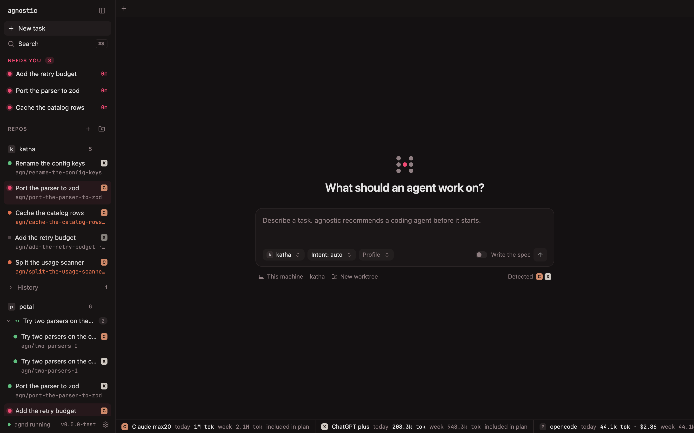
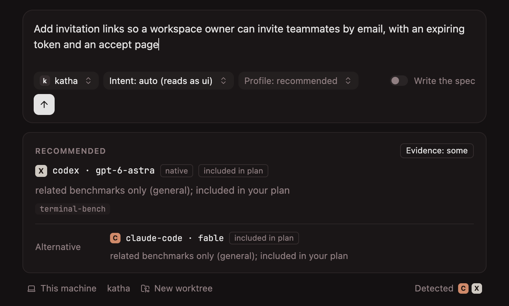
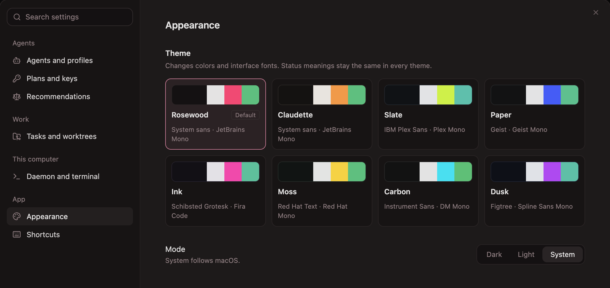

<h1 align="center">agnostic</h1>

<p align="center">
  <strong>One workspace above every coding agent.</strong><br/>
  Run Claude Code, Codex, Pi, OpenCode and the rest from one place, each task in its own worktree, and know which one to use.
</p>

<p align="center">
  
  
  
</p>

<p align="center">
  
</p>

agnostic is a local-first workspace for the coding agents you already have. Describe a task; agnostic recommends an agent and model, creates a git worktree, starts the agent's own CLI in it, and shows every running session across your repos in one window. Nothing is proxied: your agents, your logins, your keys, on your machine.

## What it does

- **Bring your own agent.** Claude Code, Codex, Pi, OpenCode, Kimi, local models, anything with a CLI. Your subscriptions and keys; agnostic never sits between you and the vendor.
- **Recommendations, not leaderboards.** One pick per task with a reason, a confidence label and the benchmarks behind it, limited to agents you can run.
- **One worktree per task.** Two tasks on one repo never share a working tree. Read the diff, open it in your editor, create the PR.
- **Native sessions.** Plan mode, approvals, permissions and subagents happen in the agent's own UI. agnostic renders the session; it does not replace it.
- **One project context.** Maintain `.ag/instructions.md`; `agn sync` writes `CLAUDE.md` and `AGENTS.md` from it, and `.ag/mcp.yaml` into each agent's MCP config.
- **Hand off and compare.** Pass a task to another agent with a structured note, or run one prompt on several agents side by side and keep one.
- **Usage and cost.** Tokens and cost per task, and every plan's usage in one bar.
- **Local, free, MIT.** No server, no account, no telemetry. The one outbound call is a daily check for a newer benchmark catalog; `catalog_check: false` in `~/.agnostic/config.yaml` turns it off.

## Install

```bash
npm i -g agnostic-dev            # puts `agn` on your PATH
agn doctor                       # which agents you have, and whether they are logged in
agn add ~/code/my-repo           # register a repo
agn ui                           # open the workspace
```

Requirements: macOS (Linux best effort), Node 22+, git, tmux 3.3+, and at least one coding agent installed and logged in. [docs/setup.md](docs/setup.md) covers each agent, and its "From a checkout" note covers running agn from a clone.

## How it works

**1. Describe the task.** New task in the workspace, or `agn run "add invitation links"`. agnostic classifies the task and shows its pick: the agent and model, why, and how much evidence stands behind the reason. Keep it or choose another.

<p align="center">
  
</p>

**2. Watch, and step in when asked.** The task runs in its own worktree, in the agent's own CLI, inside the workspace. Tasks waiting for an answer are listed under "Needs you". `agn attach` joins the same session from any terminal.

**3. Review and merge.** The Changes column lists what the task changed, unstaged, staged and committed. Open the worktree in your editor, ask the agent to commit, create the PR. Hand the task to another agent if the first one stalls.

## Workspace

<p align="center">
  
</p>

- **Command palette** (`⌘K`): every action on the selected task, and agnostic's own commands.
- **Themes.** Eight, with bundled open-licence fonts; dark, light or system.
- **Settings** for agents and profiles, plans and keys, recommendations, worktrees, the daemon and the terminal, all saved to `~/.agnostic/config.yaml`, which the CLI reads too.

## CLI

The workspace and the CLI talk to the same daemon, so anything you can click you can type.

```bash
agn run "add invitation links"     # worktree, branch, agent; the pick from agn recommend
agn status                         # every task across your repos
agn attach <task>                  # join the session in your terminal
agn handoff <task> --to codex      # stop, write a note, continue with another agent
agn compare "fix the flaky test"   # one prompt on several agents, then pick one
agn usage                          # today and this week, per plan
agn mcp                            # agnostic's commands as MCP tools for an agent
```

The full list is in [docs/cli.md](docs/cli.md).

## Supported agents

| Support | Agents |
|---|---|
| Status, usage, recommendations | Claude Code, Codex, Pi, OpenCode, OMP |
| Status hook | Gemini CLI, Cursor Agent, Copilot CLI, Kimi CLI, Factory Droid, Devin CLI, Grok CLI, Mimo Code, OpenClaude, Command Code |
| Launch and attach | Any other CLI agent, with `agn run --harness other:<binary>` |

Model overrides (Kimi in Claude Code, a local model in Codex, anything through OpenRouter) go through each agent's own mechanism with your own keys. See [docs/models.md](docs/models.md).

## Documentation

- [Setup: installing and logging into agents](docs/setup.md)
- [CLI reference](docs/cli.md)
- [Workspace](docs/workspace.md)
- [Models and providers: OpenRouter, Kimi, local models](docs/models.md)
- [Project context: `.ag/` and `agn sync`](docs/project-context.md)
- [Recommendations: how the catalog works](docs/recommendations.md)
- [Usage and cost: what agn counts](docs/usage.md)
- [Catalog: what it holds, how it updates](docs/catalog.md)
- [MCP: agn's commands as tools for an agent](docs/mcp.md)
- [Troubleshooting](docs/troubleshooting.md)

## Contributing

See [CONTRIBUTING.md](CONTRIBUTING.md). Code is MIT; [PROVENANCE.md](PROVENANCE.md) says what was adapted from elsewhere.
